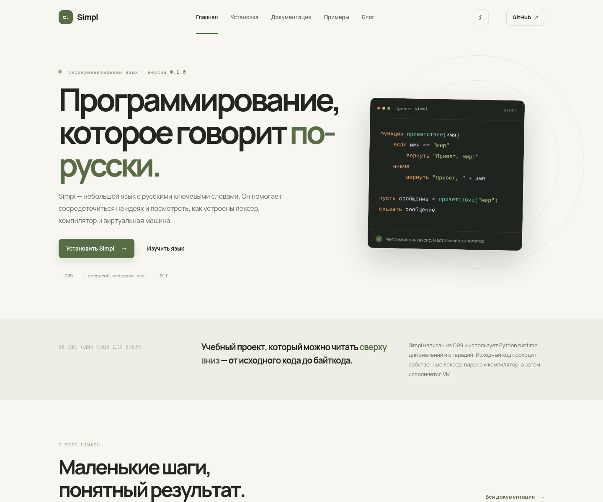

# Simpl

[](https://github.com/ZolVo-o/simpl/actions/workflows/build.yml)

Simpl — небольшой экспериментальный язык программирования с русскими ключевыми словами, созданный как учебный проект для начинающих и тех, кому интересно устройство языков программирования. Проект написан на C99; Python служит средой выполнения для значений и операций, а исходный код Simpl исполняется собственной виртуальной машиной.

Исходный код, обсуждение задач и сообщения об ошибках доступны в [репозитории Simpl на GitHub](https://github.com/ZolVo-o/simpl).

> Проект находится в разработке. CLI, компилятор и VM уже позволяют запускать `.sim`, сохранять байткод `.simc` и дизассемблировать его. Интерфейс и семантика языка ещё могут изменяться.

## Программа за 5 строк

```simpl
пусть имя = "мир"
пусть число = 5
если число > 0
    сказать "Привет, " + имя
сказать число
```

Сохрани код в `hello.sim` и запусти командой `./simpl run hello.sim`. Подробнее об установке — в разделе [быстрого старта](#быстрый-старт).



## Возможности

- Переменные, числа, строки, логические значения и выражения.
- Условия, циклы, функции и рекурсия.
- Списки, словари, индексация и цикл `для каждого`.
- 29 встроенных функций для строк, коллекций, чисел, времени, файлов и аргументов запуска; полный список — в [справочнике](docs/builtins.md).
- Обработка runtime-ошибок через `попробовать` / `поймать`.
- Компиляция в `.simc`, сериализация и дизассемблирование.
- Расширение VS Code с подсветкой `.sim`, сниппетами и командами запуска/компиляции.

## Быстрый старт

### Установка готового бинарника (Linux x86_64 / macOS)

Скрипт скачает последний релиз в `~/.local/bin/simpl`. Для запуска нужен Python 3.12 runtime; на macOS также требуется Python 3.12 framework от python.org.

```sh
curl -fsSL https://raw.githubusercontent.com/ZolVo-o/simpl/main/tools/install.sh | sh
```

Для установки в другой каталог задайте `SIMPL_INSTALL_DIR`:

```sh
SIMPL_INSTALL_DIR="$HOME/bin" sh tools/install.sh
```

### Linux

На Debian/Ubuntu установите компилятор C, Make и заголовки Python:

```sh
sudo apt-get install build-essential make python3-dev
```

### macOS

Установите Xcode Command Line Tools и Python 3 с заголовками разработки. `python3-config --cflags` и `python3-config --embed --ldflags` должны быть доступны из `PATH`.

Для Homebrew-установки из formula в этом репозитории выполните `brew install ./Formula/simpl.rb`. Она собирает Simpl из исходников и использует Homebrew Python 3.12; опубликованный macOS-бинарник для этого не подходит, поскольку связан с Python Framework от python.org. Formula пока не опубликована в отдельном tap.

### Windows

Windows installer требует заранее установленный MSYS2 в `C:\msys64` и Python 3.14 из окружения UCRT64. В терминале MSYS2 UCRT64 выполните:

```sh
pacman -S mingw-w64-ucrt-x86_64-python
```

Затем скачайте `simpl-<версия>-windows-setup.exe` со страницы GitHub Releases и запустите установщик. Он проверяет наличие стандартной библиотеки Python 3.14. Для запуска используйте ярлык Simpl в меню «Пуск» или `simpl.cmd` из каталога установки: скрипт задаёт `PYTHONHOME` и вызывает установленный бинарник. Сам установщик включает Simpl и необходимые DLL, но не поставляет Python runtime.

Для сборки из исходников также нужны `mingw-w64-ucrt-x86_64-gcc` и `make`; сборку выполняйте из окружения UCRT64.

### Сборка и тесты

Из корня проекта:

```sh
make
make test
```

Для проверки владения Python-объектами в debug allocator:

```sh
PYTHONMALLOC=debug ./test_compile
```

### Запуск программы

Сохраните программу в `hello.sim`:

```simpl
пусть имя = "мир"
сказать "Привет, " + имя
```

Команды CLI:

```sh
./simpl run hello.sim
./simpl compile hello.sim       # создаёт hello.simc
./simpl compile hello.sim -o build/hello.simc
./simpl disasm hello.simc
./simpl check hello.sim
./simpl fmt hello.sim
./simpl doc hello.sim
./simpl new my-project
./simpl repl
```

`run` принимает исходный `.sim` или скомпилированный `.simc`; аргументы после файла доступны в программе через `arguments()`. Разделитель `--` можно использовать, чтобы явно отделить аргументы CLI:

```sh
./simpl run hello.sim first -- --option
```

`compile ... -o -` записывает байткод в stdout. `disasm` поддерживает `--no-names` и `--stats`. Команда `doc` выводит строки комментариев, начинающиеся с `##`, а `fmt` форматирует исходный файл на месте. В REPL пустая строка выполняет введённый блок, Ctrl+D завершает работу.

Ошибки CLI и файлового ввода/вывода завершаются кодом 1, ошибки компиляции — 2, ошибки времени выполнения — 3; прерывание Ctrl+C возвращает 130. Справка доступна через `simpl --help`, версия — через `simpl --version`.

Если `simpl` установлен в `PATH`, префикс `./` не нужен.

Собранный бинарный файл связан с Python runtime той же версии, что использовалась при сборке. Для запуска релизного бинарника установите соответствующий Python runtime; автономная поставка Python пока не настраивается.

## Пример

```simpl
функция факториал(число)
    если число <= 1
        вернуть 1
    иначе
        вернуть число * факториал(число - 1)

сказать факториал(5)
```

Другие примеры находятся в [`examples/`](examples/), нормативная [спецификация версии 0.2](docs/specification.md) фиксирует поведение языка, справочник синтаксиса — в [`docs/syntax.md`](docs/syntax.md), встроенных функций — в [`docs/builtins.md`](docs/builtins.md), учебник — в [`docs/tutorial.md`](docs/tutorial.md), а рекомендации по диагностике и исправлению ошибок — в [`docs/errors.md`](docs/errors.md).

## VS Code

Откройте `editors/vscode/` в VS Code и нажмите F5 для запуска Extension Development Host. Расширение подсвечивает `.sim` и `.simpl` и предоставляет команды запуска, компиляции, проверки, форматирования, создания проекта, REPL, документации и дизассемблирования. См. [инструкцию расширения](editors/vscode/README.md).

Укажите путь к бинарному файлу в `simpl.path`, если он не доступен как `simpl` из `PATH`.

## Структура проекта

```text
src/                    # лексер, парсер, компилятор, VM и сериализация
tests/                  # тесты языка и CLI
examples/               # программы Simpl
docs/                   # справочник и учебник
site/                   # сайт проекта для GitHub Pages
editors/vscode/         # расширение VS Code
.github/workflows/      # CI, сборка релизов и публикация сайта
```

## Участие в разработке

Перед отправкой изменений прочитайте [`CONTRIBUTING.md`](CONTRIBUTING.md) и запустите `make test`. Код распространяется на условиях MIT; см. [`LICENSE`](LICENSE).
